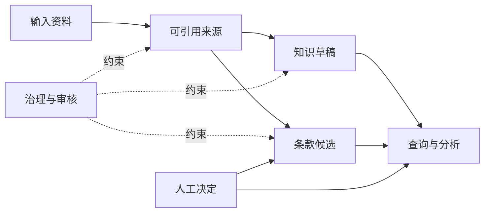
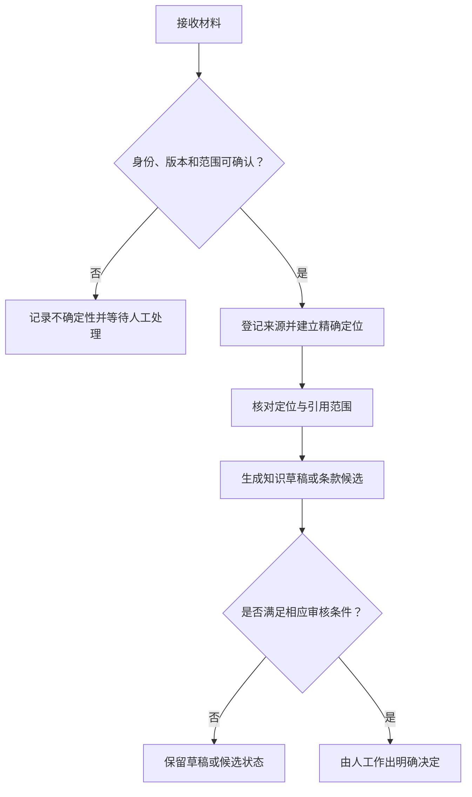

# 系统架构：先分层，再连接

PLCI 的起点不是让模型直接回答问题，而是先明确每类信息的位置和职责。材料、知识表达、起草资产与治理记录分开保存；它们之间可以建立链接，但不能互相替代。

## 四个对象层

| 层 | 保存内容 | 不应被误当成 |
| --- | --- | --- |
| 输入资料 | 尚待分类、转换或核对的文件 | 可直接支持结论的证据 |
| 可引用来源 | 已登记身份、版本和定位的原始文本 | 已完成法律分析的知识 |
| 知识草稿 | 对规则、概念、争点或状态的结构化表达 | 自动获得人工认可的结论 |
| 条款候选 | 可供审查的起草措辞及其适用信息 | 可直接用于所有交易的模板 |
| 治理记录 | 规则、索引、待审事项和变更依据 | 实体法律来源或业务事实 |

这种结构让不同问题有自己的处理路径。例如，来源文本是否准确、某一观点能否被引用、某条款是否许可复用，分别需要不同的核验，而不是用一个“已完成”标签概括。

## 从材料到可使用信息

这个流程强调两个先后关系：身份先于引用，来源先于概括。前者避免不同版本或不同对象被混淆；后者避免模型生成的摘要先于其可回溯的依据存在。

## Markdown-first 的含义

方法论采用人类可读的文档作为业务表达的载体。这样做不是否认数据库、检索系统或应用界面的价值，而是优先保证：

- 人可以直接查看来源、状态和变更上下文；
- 链接与定位可以被独立检查；
- 系统实现更换时，关键记录仍保持可阅读；
- 自动化工具只能在预先定义的边界内更新文档。

因此，PLCI 不是公开 SaaS，也不是一套“上传资料即可得到法律答案”的承诺。它是一种将 AI 纳入受控法律工作流的设计思路。

## 查询时的基本纪律

查询应从结构化索引与相关知识对象开始，再回到原始来源核验关键依据。系统应显式暴露草稿、待核对、过期或需复审状态，而不因为回答读起来流畅就隐藏这些限制。

下一步可阅读 [可追溯性与证据边界](traceability-and-evidence.md)。
