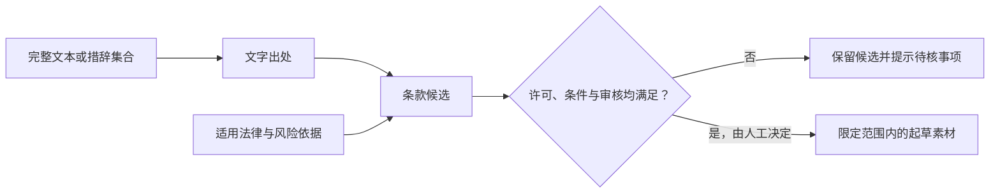

# 条款库边界：文字来源不等于法律依据

合同起草是法律 AI 最容易产生“可直接使用”错觉的场景。PLCI 因此将完整合同文本、用户维护的措辞集合、候选条款与人工批准的起草素材视为不同对象。

## 四类对象，四种问题

| 对象 | 它回答的问题 | 它不回答的问题 |
| --- | --- | --- |
| 完整合同文本 | 某种表述出现在哪里？ | 该表述是否适用于新交易 |
| 措辞集合 | 某条表达的维护来源是什么？ | 该表达是否具有法律依据 |
| 条款候选 | 哪种表述值得进一步审查？ | 是否已可直接复用 |
| 批准的起草素材 | 在明确条件内是否可被起草时优先考虑？ | 对所有主体、地区或交易均有效 |

## 两条独立链路

每个条款候选至少需要区分两种链接：

- **文字出处**：说明这段措辞来自何处，便于核对原始表达、上下文和版本；
- **法律依据或风险依据**：说明为什么某种安排可能需要、受限或存在谈判风险。

一段合同文字即使可追溯，也不会因此变成法律依据；反过来，某项法律依据也不会自动提供适合所有交易的合同表述。将两者拆开，才能让检索结果诚实地展示其用途。

## 复用不是单一开关

条款是否可被复用至少涉及以下问题：

1. 文字来源是否允许在拟定范围内使用；
2. 来源版本和文字定位是否已被必要程度地核对；
3. 适用文书类型、主体立场、司法辖区和交易条件是否匹配；
4. 变量、例外、排除条件和谈判风险是否已向使用者显露；
5. 是否有人工对该具体版本作出明确决定。

因此，候选、已批准、已退休和需复审应被视为不同的可见状态。已批准文本发生实质变化时，应形成可追溯的新版本，而不是无痕覆盖原文本。

## 这套边界避免什么

- 将公开可见文本误当成当然可自由复用的内容；
- 将用户维护的措辞误标为法律结论；
- 将高优先级或常用条款误表述为已获批准；
- 在来源、法律依据或交易条件变化后继续静默推荐旧文本。

这份方法论不公开任何真实合同、条款、来源或起草结果。它只说明在使用此类材料时，系统应该如何保持出处、许可和法律判断之间的清晰边界。
